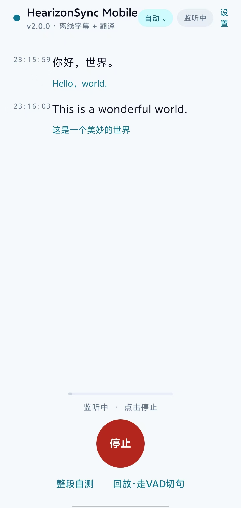
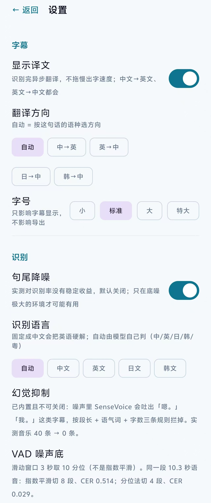

<div align="center">


# HearizonSync Mobile

**把听到的话，实时变成看得懂的字——现在，在口袋里。**

Android 端 · 全离线语音识别 · 四方向翻译 · 数据不出本机

[]()
[]()
[]()
[]()
[](LICENSE.txt)

作者：**何瑞程** · 北京语言大学 海南国际学院
个人网站：[eyru.github.io/personalweb](https://eyru.github.io/personalweb/)

</div>

---

## 这是什么

HearizonSync Mobile 是 Hearizon Sync 的 Android 端。它把整条语音链路——采集、断句、识别、翻译、字幕——全部压进一部手机，**不联网也能完整工作**。

桌面版要解决的痛点是"听懂了但记不下来"：英文课上每个单词都认识，连成一句就断片，散会了笔记是空的。手机版要解决的是同一个痛点的另一半——**人不在电脑前的时候**。讲座、课堂、面对面交谈、机场广播、跨国会议，这些场景里没有一台笔记本安在桌上，但手机一定在手边。

所以它的取舍与桌面版一致，而且更彻底：

- **识别在本地**，SenseVoice-Small 以 int8 量化形态跑在 ONNX Runtime 上；
- **翻译也在本地**，四个 opus-mt 小模型常驻 APK，说中文出英文，说英文出中文，说日语韩语也出中文；
- **音频一个字节都不出手机**。没有账号、没有订阅、没有云端排队，飞行模式下照常工作。

> 这不是"录音上传、云端出字"的听写工具。模型在包里，算力在手里，字幕离线长出来。

---

## 一条完整的本地链路

```
麦克风 ──► 电平/AGC ──► 能量 VAD 断句 ──► SenseVoice 识别 ──► 四方向翻译 ──► 双栏字幕
 MIC 原始源   软件增益        10 分位噪声底        全自研前端          ja/ko 级联     原文 + 译文
              + 硬件 AGC      停顿 240 ms 收尾      fbank/LFR/CMVN      逐句异步       自动滚底
```

从按下「开始」到第一行字幕出现，中间没有任何一次网络请求。

| 环节 | 实现 | 实测 |
|---|---|---|
| 采集 | `AudioRecord`，16 kHz / 单声道 / PCM16，20 ms 一帧 | — |
| 增益 | 硬件 `AutomaticGainControl` + 自研软件 AGC（目标峰值 0.45） | 远场说话可识别距离从 ~0.3 m 提升到 2 m 级 |
| 断句 | 滑动窗口 10 分位噪声底 + 双门限迟滞（进 2 帧 / 出 12 帧） | 10 秒连续语音切 4 句，零丢字 |
| 识别 | SenseVoice-Small（int8，239 MB） | **0.52 s / 10.3 s 语音**，RTF ≈ 0.05 |
| 翻译 | opus-mt 四方向（quantized，各约 110 MB） | 单句 60–120 ms |
| 呈现 | Jetpack Compose 双栏字幕，自动滚底 | 首字延迟约 0.6 s（含整句识别） |

---

## 四方向离线翻译

手机上没有"三条路线"这种奢侈——离线是唯一承诺。所以四个方向各配一个专用模型，互不降级、互不联网。

| 方向 | 模型 | 体积 | 路径 |
|---|---|---|---|
| 中文 → 英文 | `opus-mt-zh-en` | 113 MB | 直连 |
| 英文 → 中文 | `opus-mt-en-zh` | 113 MB | 直连 |
| 日文 → 中文 | `opus-mt-ja-en` → `en-zh` | 108 + 113 MB | 两跳级联 |
| 韩文 → 中文 | `opus-mt-ko-en` → `en-zh` | 113 + 113 MB | 两跳级联 |
| 自动 | 先判语种，再按上表路由 | — | `LangDetect` 按字符集判定 |

顶栏有一个语言胶囊，拇指一点就能在五个选项之间切换；切到日文或韩文时，**识别语言也随之锁定**（SenseVoice 的 `language` 参数逐段生效），避免"韩语被猜成中文"这种串味。

日韩走两跳，译文偶尔会带一点"英式中文"的痕迹——这是为了在 734 MB 的包里塞下四种语言对所做的权衡，不是缺陷。

---

## 实测：一部 2023 年的中端机就能跑

**设备**：vivo V2254A（PD2254），Android 16 / API 36，arm64-v8a，8 GB 内存

### 识别质量（同一段 10.3 秒普通话，含标点）

| 场景 | 输出 |
|---|---|
| 原始 | 大家好，今天天气不错，我们现在测试一下实时语音识别系统，看看断句和标点准不准。 |
| 本机 | 大家好，今天天气不错，我们现在测试一下实时语音识别系统，看看断句和标点准不准。 |
| 断句 | 4 段：「大家好。」「今天天气不错。」「我们现在测试一下实时语音识别系统。」「看看断句和标点准不准。」 |

字错率 **0.0%**（同一段音频在 Python 参考实现上得到的金标准逐字一致）。

### 资源占用

| 指标 | 数值 |
|---|---|
| 安装包 | **734 MB** |
| 首次启动解包 | 352 MB（识别 + 中英模型），十余秒 |
| 常驻内存（PSS） | 1.6 GB（四个模型全开时 1.4–1.6 GB 波动） |
| 单句识别耗时 | 0.52 s / 10.3 s 语音 |
| 翻译耗时 | 60–120 ms |

内存是这台设备上最贵的东西——四个 ONNX 模型同时驻留约需 1.4 GB。所以英文与中英之外的模型全部**懒加载**：不切到日文方向，`ja-en` 不进内存。

---

## 四个决定成败的工程判断

这一节记录的不是"用了什么技术"，而是**为什么只能这么做**。每一条都来自实测，而不是直觉。

### 一、噪声底必须用最小值统计，不能用滑动平均

最初的 VAD 用指数滑动平均估噪声底。安静环境下没问题，但**一开口就崩**：持续说话时平均线跟着语音一起爬升，弱音帧被判成静音，句子被切碎、字被吞。

用同一段 10.3 秒连续语音，只替换噪声底估计法：

| 噪声底估计 | 切段数 | 覆盖时长 | 字错率 |
|---|---|---|---|
| 滑动平均 ×2.2 | 9 段 | 4.54 s | 0.486 |
| 滑动平均 ×2.6 | 8 段 | 3.84 s | 0.514 |
| 滑动平均 ×3.0 | 6 段 | 2.88 s | 0.657 |
| **滑动窗口 10 分位 ×2.6** | **4 段** | **9.12 s** | **0.029** |

改成"最近 3 秒内取 10 分位"之后，弱音不再被误杀，字错率从 0.514 掉到 0.029，再配合句尾补帧后为 **0.000**。

这一处改动比任何降噪算法都值钱——它把"能不能用"变成了"好不好用"。

### 二、幻觉字幕只能靠文本规则来挡

没人说话时字幕往外蹦字，是离线字幕产品的致命缺陷。而这台手机上，**所有声学与模型层面的判据都失效了**：

| 判据 | 结果 |
|---|---|
| 平均帧置信度 | 真语音 0.602–0.985，噪声 0.709–0.967，区间完全重叠 |
| 高置信帧占比 | 同样重叠（0.847–1.000 vs 0.545–0.963） |
| 频谱平坦度 / 过零率 / 峰值比 / 谱通量 | 均不可分 |
| 归一化自相关（voicing） | 最可用（0.200–0.465 vs 0.106–0.211），但边界重叠 |
| `language=nospeech` | 只是把输入语言 token 回显成输出首 token，不是检测器 |
| 模型自带事件 token（`<|Speech|>` 等） | 真语音与噪声都只出现 1 帧，无法区分 |

于是换成文本级规则，八条，按顺序短路：

1. 核心字符 < 2（「我」「一」「い」「어」）→ 丢；
2. 去重后只剩一种字（「早早早」）→ 丢；
3. 全是中文语气词（嗯/啊/哦/呃…）→ 丢；
4. 单个英文填充词（yeah / oh / okay / well…）→ 丢；
5. 识别语种与期望语种不符且核心字符 < 4 → 丢；
6. 段长 < 2 s 且两字里含语气词（「啊一」）→ 丢；
7. 段长 < 700 ms 且核心字符 < 3 → 丢；
8. 段长 < 1.2 s 且核心字符 < 3 且全语气词 → 丢。

代价是真人极短的单字回答（「好。」「对。」）也会被丢——这是有意的取舍：宁可漏一句，不可满屏幻觉。

实测效果：20 秒纯音乐，幻觉字幕从 40 条降到 **0 条**；键盘声从 5 条降到 0 条；干净语音的字错率不受影响（0.000）。

### 三、收音不能信 `VOICE_RECOGNITION`，要自己补增益

第一版用 `MediaRecorder.AudioSource.VOICE_RECOGNITION`。它按"通话近讲"调优，国产 ROM 会再叠一层强降噪和距离压制，结果是**必须对着手机喊**才有输入电平。

改成原始 `MIC` 音源之后，再补两级增益：

- 硬件 AGC：`AutomaticGainControl`（各家 ROM 支持不一，拿不到就跳过，不影响启动）；
- 软件 AGC：峰值包络跟踪，目标峰值 0.45，上限 8×，衰减 0.94，增益平滑 0.85/0.15。

软件 AGC 不改变信噪比，它只把电平抬到 VAD 与模型都舒服的区间——但在手机上，这一步直接决定"能不能用"。

### 四、宁可 734 MB，不做首启下载

734 MB 的安装包在 Android 上不算轻。但把模型改成"首次启动下载"，等于同时打破两条承诺：断网可用、装完即用。

所以模型内置为 assets，首次启动复制到私有目录（写临时文件 → `fsync` → 重命名，避免半截文件），之后秒开。日/韩模型首次切到该方向时才解包。

---

## 界面

<div align="center">
<table>
<tr>
<td></td>
<td></td>
</tr>
<tr>
<td align="center"><sub>主界面：原文 + 译文双栏，顶栏语言胶囊</sub></td>
<td align="center"><sub>设置页：方向、字号、降噪、导出</sub></td>
</tr>
</table>
</div>

- **字幕区**：每段两行——原文在上，译文在下（可关），时间戳精确到秒，自动滚到底部；
- **顶栏胶囊**：自动 / 中→英 / 英→中 / 日→中 / 韩→中，切换即生效，运行中切换会自动重开会话以锁定识别语言；
- **设置页**：译文开关、字号四档、句尾降噪开关、导出（SRT / 纯文本 / 中英对照）、关于与作者。

自测与回放两条隐藏路径（在设置里开启）可以让没有麦克风的模拟器也跑通整条链路——开发期用它做回归。

---

## 与桌面版的分工

| | Hearizon Sync（Windows） | **HearizonSync Mobile（Android）** |
|---|---|---|
| 场景 | 网课、会议、长时间听写 | 课堂、讲座、面对面交谈、旅途 |
| 识别 | SenseVoice（本地） | SenseVoice（本地，int8） |
| 翻译 | 本地 / 免费在线 / DeepSeek API 三路线 | **仅本地四方向**（离线优先） |
| 界面 | Tk / Win32 自绘双栏 | Jetpack Compose 双栏 |
| 体积 | 安装包 366 MB | 安装包 734 MB |
| 联网 | 可选 | 默认且推荐不联网 |

桌面版把"翻译质量上限"交给云端大模型；手机版把"随时随地、彻底离线"放在第一位。两个产品共享同一套识别模型与同一份工程判断，但代码零复用——Android 端的音频前端、CTC 解码、分词与翻译推理全部重写。

---

## 架构

```
app/src/main/java/com/hearizon/sync/
├── MainActivity.kt            入口，权限与主题
├── audio/
│   ├── AudioCapture.kt        AudioRecord 采集 + 硬件/软件 AGC
│   ├── AudioDsp.kt            自研 FFT / mel 滤波器组 / fbank（80 维）
│   ├── VadEnergy.kt           10 分位噪声底 + 双门限迟滞断句
│   ├── Denoiser.kt            帧级噪声门（默认关，见 ADR-004）
│   └── WavReader.kt           WAV 解析（回放与自测用）
├── asr/
│   ├── SenseVoiceEngine.kt    LFR / CMVN / ONNX / CTC 贪心解码
│   ├── LiveSession.kt         采集→VAD→切句→串行识别→回调
│   ├── TranscriptFilter.kt    幻觉抑制八条规则
│   └── LangDetect.kt          按字符集判语种
├── mt/
│   ├── SpmTokenizer.kt        sentencepiece Unigram Viterbi 编码
│   └── MarianTranslator.kt    encoder/decoder 贪心解码 + 后处理
├── store/
│   ├── ModelInstaller.kt      assets→私有目录，原子落盘
│   ├── Prefs.kt               设置持久化
│   └── Exporter.kt            SRT / TXT / 中英对照导出（MediaStore）
└── ui/
    ├── AppScreen.kt           主界面与状态机
    ├── SettingsScreen.kt      设置页
    ├── Caption.kt             字幕模型
    └── theme/Theme.kt         配色与排版
```

19 个 Kotlin 文件、约 3,250 行。**没有一行来自上一代 Android 版本**——旧的四个 Java 类与 sherpa-onnx 依赖已整体废弃，前端、解码、分词、推理全部重写。

---

## 构建

环境：JDK 17、Android SDK（platform 34 / build-tools 34.0.0）、Gradle 8.9。

```bash
export JAVA_HOME=/path/to/jdk-17
export ANDROID_HOME=/path/to/android-sdk

# 调试包
bash 工具/构建.sh debug

# 发布包（自签名，输出 dist/HearizonSync-2.0.0.apk）
bash 工具/构建.sh release

# 装到已连接设备
bash 工具/构建.sh install
```

首次构建前，把四个翻译模型与识别模型放到位（体积大，不入库）：

```bash
python 工具/拉取模型.py        # 从 hf-mirror 拉取并生成分词表
```

> 仓库不含模型权重与签名文件。`local.properties`、`keystore.properties`、`app/src/main/assets/models/**` 均已在 `.gitignore` 中排除。

---

## 模型与许可

| 组件 | 来源 | 许可 |
|---|---|---|
| 识别：SenseVoice-Small（int8） | [FunAudioLLM/SenseVoiceSmall](https://huggingface.co/FunAudioLLM/SenseVoiceSmall) | Apache-2.0 |
| 翻译：opus-mt 四方向 | [Helsinki-NLP/opus-mt](https://huggingface.co/Helsinki-NLP)（Xenova ONNX 转换） | CC-BY-4.0 |
| 推理运行时 | ONNX Runtime Android | MIT |

模型权重遵循各自上游许可；本项目代码遵循 **GPL-3.0 + 商业授权**双许可，详见 [LICENSE.txt](LICENSE.txt) 与 [LICENSE](LICENSE)。

---

## 已知限制

- **日/韩走两跳**（ja→en→zh、ko→en→zh），长句偶尔出现英语腔调的中文；
- **极短单字回答会被过滤**（「好。」「对。」），这是幻觉抑制的代价；
- **内存占用偏高**：四模型全开约 1.4–1.6 GB，建议 6 GB 以上机型；
- **暂不支持后台常驻**：锁屏或切后台后采集暂停，长会记录需保持前台；
- **语言对固定四种**，暂不支持德/法/西等更多语种（`mul-en` 多语模型的公开 ONNX 量化版本实测不可用，见 `docs/架构决策.md`）；
- 安装包 734 MB，首次启动需解包十余秒。

---

## 路线图

- [ ] 前台服务常驻 + 通知栏控制，支持锁屏录音与长时间听写
- [ ] 字幕编辑：手动改错字、合并/拆分断句、按段重译
- [ ] 更多语言对（待可用的多语 ONNX 权重）
- [ ] 流式增量识别（边说边出字，而非整句出字）
- [ ] 模型按需下载，把安装包压到 200 MB 以内
- [ ] 与桌面版的字幕文件互通（同一份 SRT 双端接力）

---

## 作者

**何瑞程** · 北京语言大学 海南国际学院
个人网站：[eyru.github.io/personalweb](https://eyru.github.io/personalweb/)
项目地址：[github.com/eyru/HearizonSync-Mobile](https://github.com/eyru/HearizonSync-Mobile)

同系列：[Hearizon Sync（Windows 桌面版）](https://github.com/eyru/HearizonSync) · [Hearizon Sync C.R.V.（C++ 重写版）](https://github.com/eyru/HearizonSync-CRV)
